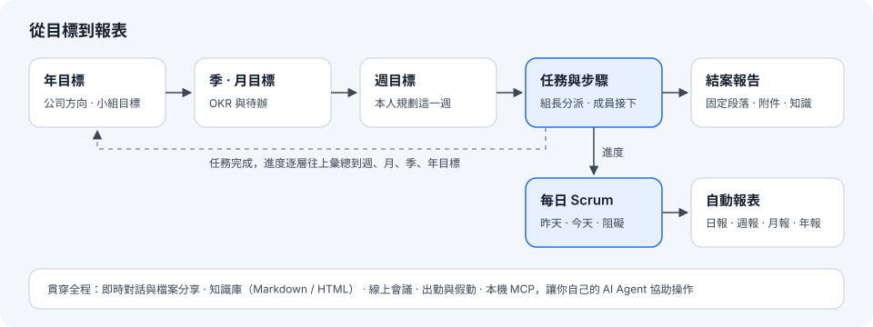
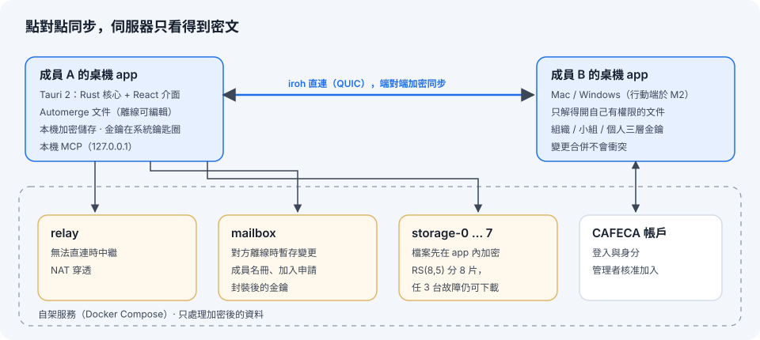
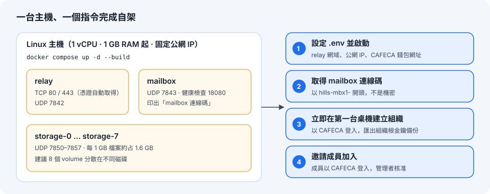

# 山丘上的卡菲卡
**站在山丘上，俯瞰團隊前進方向**

CAFECA 團隊的協作工具，提供成員安排與回報每日 Scrum 的任務，自動化生成的日報、週報、月報、年報，並提供即時通訊服務與線上會議平台。

## 用途

Hills 把團隊每天的工作串成一條線：**目標 → 任務 → Scrum → 報表**。成員在自己的電腦上規劃與回報，組長看得到誰在做什麼、卡在哪裡，報表由系統自動產生，不必再另外整理。

<p align="center"></p>

| 功能 | 說明 |
|------|------|
| 目標 | 年 → 季 → 月 → 週四層目標（OKR）；管理者訂公司方向、組長訂小組目標，個人目標對齊上去 |
| 任務 | 週目標之下的任務與步驟；組長在「依成員」分派板指派，成員接下並連到自己的週目標 |
| 每日 Scrum | 昨天做了什麼、今天要做什麼、遇到的阻礙；自動帶入今天的任務 |
| 自動報表 | 由 Scrum、任務完成紀錄與目標進度產生日報、週報（月報、年報陸續加入），可列印或存成 PDF |
| 即時對話與檔案 | 一對一與群組對話；檔案、資料夾端對端加密分享 |
| 知識庫 | 全組織共用，Markdown 或 HTML，固定段落（摘要、內容、重點、來源）方便閱讀與擷取 |
| 出勤與假勤 | 打卡、請假、加班、補打卡與多層核准（M1 進行中） |
| AI 代理 | 桌機 app 內建本機 MCP，讓你自己的 AI Agent 查詢與整理；所有修改都要你在 Hills 按核准 |
| 線上會議 | 規劃於 M4 |

## 原理

<p align="center"></p>

- **每台桌機都是一個節點。** 資料存成 [Automerge](https://automerge.org/) 文件，離線也能編輯，連線後自動合併、不會出現衝突對話框。
- **端對端加密。** 組織、小組、個人各有一層金鑰（GK / TK / PK），只有有權限的成員解得開；金鑰存在系統鑰匙圈，本機資料靜態加密。
- **點對點同步。** 成員之間以 [iroh](https://iroh.computer/)（QUIC）直連；穿不過 NAT 時經 relay 中繼，對方離線時暫存在 mailbox，上線後補傳。
- **檔案不經任何人的明文。** 檔案在 app 內逐條帶 AES-256-GCM 加密，再以 Reed-Solomon (8,5) 分成 8 片存到 8 個儲存節點，任 3 個節點故障仍能還原（SwarmStorage 原理）。
- **伺服器只看得到密文。** relay、mailbox、storage 都是自架服務，看不到訊息、文件或檔名；身分以 CAFECA 帳戶登入，新成員由管理者核准。

協定、資料模型與金鑰流程的細節見 [docs/technical-design.md](docs/technical-design.md)。

## 部署

<p align="center"></p>

需要一台有固定公網 IP 的 Linux 主機（Docker Engine 24+、Docker Compose v2）與一個指向它的子網域；防火牆開放 TCP 80、443，UDP 7842、7843、7850–7857。

```bash
git clone https://github.com/CAFECA-IO/hills.cafeca.io.git
cd hills.cafeca.io/deploy
cp .env.example .env                 # 填 HILLS_RELAY_HOST、HILLS_RELAY_CONTACT、HILLS_PUBLIC_IP、HILLS_CAFECA_WALLET
docker compose up -d --build         # 第一次約 10–20 分鐘
docker compose logs mailbox | grep 連線碼   # 取得 mailbox 連線碼（hills-mbx1-…，不是機密）
```

部署完成後**立即**在第一台桌機建立組織（mailbox 會綁定第一個建立的組織），並匯出組織根金鑰備份。完整步驟、環境變數、備份與升級見 [docs/deploy.md](docs/deploy.md)。`.env` 不要提交到 repo。

## 操作方法

**第一次使用**

1. 安裝桌機 app（Mac 的 `.dmg`，或 Windows 的 `.exe` / `.msi`；目前安裝檔未簽章，見下方「開發環境」的開啟方式）。
2. **管理者**選「建立組織」，貼上 mailbox 連線碼，以 CAFECA 登入，匯出組織根金鑰備份。
3. **成員**選「加入組織」，貼上管理者給的連線碼並以 CAFECA 登入，等待管理者在「設定 → 成員與小組」核准。
4. 管理者建立小組、指定組長（設定 → 成員與小組 → 小組）。

**每天**

| 時機 | 在哪裡 | 做什麼 |
|------|--------|--------|
| 早上 | 首頁 | 看「今天的山」（焦點任務）、新指派給你的任務，按「接下」或「有困難」 |
| 早上 | Scrum | 確認自動帶入的今日任務，送出 Scrum |
| 工作中 | 任務 | 勾完成步驟；組長在「依成員」分派板拖曳指派、看負荷 |
| 工作中 | 訊息、知識庫 | 對話、分享檔案；把有用的內容存成知識 |
| 每週 | 目標 | 規劃這一週的週目標，檢查與小組目標的對齊 |
| 隨時 | 報表 | 查看自動產生的日報、週報，確認後發佈給小組 |

**讓 AI Agent 協助**：管理者在「設定 → 組織」允許 AI 代理後，成員可在「設定 → 個人 → AI 代理（MCP）」開啟，把顯示的位址與 token 設定到 Claude Code、Claude Desktop 等 Agent。Agent 的每一項修改都會出現在 Hills 右下角的確認卡，按「核准」才會寫入。

## 開發環境

> [!IMPORTANT]
> **Node.js 必須 ≥ 24.22.1。** CVE-2026-111497 是 Node.js 內建 Brotli 解碼器的高風險漏洞（可由惡意壓縮資料觸發），已在 24.22.1 修正。repo 以 `package.json` 的 `engines` 搭配 `.npmrc` 的 `engine-strict=true` 強制檢查，版本不足時 `pnpm install` 會直接失敗；`.nvmrc` 指定 24，CI 使用 Node 24 最新版。檢查目前版本：`node -v`。

| 工具 | 版本 |
|------|------|
| Rust | stable（見 `rust-toolchain.toml`，需 ≥ 1.91） |
| Node.js | **24.22.1 以上**（[CVE-2026-111497](https://nodejs.org/en/blog/vulnerability/october-2026-security-releases)，見下方說明） |
| pnpm | 10（`corepack enable`） |

### macOS

1. 安裝工具（第一次）：

   ```bash
   xcode-select --install                                          # Xcode Command Line Tools
   curl --proto '=https' --tlsv1.2 -sSf https://sh.rustup.rs | sh   # Rust
   brew install node@24                                            # 或 nvm install 24（需 ≥ 24.22.1）
   corepack enable                                                 # 啟用 pnpm
   ```

2. 安裝依賴並以開發模式啟動（會開出 app 視窗，改前端程式碼即時更新）：

   ```bash
   pnpm install
   pnpm --filter @hills/desktop tauri dev
   ```

3. 編譯安裝檔：

   ```bash
   pnpm --filter @hills/desktop tauri build
   ```

   產出在 `target/release/bundle/`：`macos/Hills.app`、`dmg/Hills_<版本>_aarch64.dmg`。

   同時支援 Apple Silicon 與 Intel Mac 的安裝檔：

   ```bash
   rustup target add aarch64-apple-darwin x86_64-apple-darwin
   pnpm --filter @hills/desktop tauri build --target universal-apple-darwin
   ```

4. 目前的安裝檔沒有簽章（M1「安裝檔簽章與自動更新」處理），第一次開啟會被阻擋：到「系統設定 → 隱私權與安全性」按「仍要打開」，或執行 `xattr -cr target/release/bundle/macos/Hills.app`。

### Windows

1. 安裝工具（第一次）：
   - **Visual Studio Build Tools**：勾選「使用 C++ 的桌面開發」
   - **Rust**：https://rustup.rs 下載 `rustup-init.exe`，使用預設的 MSVC 工具鏈
   - **Node.js 24（≥ 24.22.1）**：https://nodejs.org 下載 24 LTS 安裝檔
   - **pnpm**：以系統管理員身分開 PowerShell 執行 `corepack enable`，或 `npm install -g pnpm`
   - **WebView2**：Windows 10 / 11 已內建

2. 安裝依賴並以開發模式啟動（PowerShell）：

   ```powershell
   pnpm install
   pnpm --filter @hills/desktop tauri dev
   ```

3. 編譯安裝檔：

   ```powershell
   pnpm --filter @hills/desktop tauri build
   ```

   產出在 `target\release\bundle\`：`nsis\Hills_<版本>_x64-setup.exe`、`msi\Hills_<版本>_x64_en-US.msi`。第一次編譯時 Tauri 會自動下載 NSIS 與 WiX。

4. 安裝檔沒有簽章，SmartScreen 會警告：點「其他資訊 → 仍要執行」。

### Linux

需要 `libwebkit2gtk-4.1-dev libgtk-3-dev librsvg2-dev libayatana-appindicator3-dev`；Linux 桌機版於 M2 發佈（D34）。

### 測試與常用指令

```bash
cargo test --workspace && pnpm -r test      # 全部測試
cargo run --release -p net-echo -- listen   # PoC：iroh 連線測試（見 docs/poc-report.md §5）
```

檔案管線效能測試：以開發模式開啟 app，點右下角「開發工具：檔案管線效能測試」。其他指令見 [AGENTS.md §7](AGENTS.md#7-常用指令)。

### 本機試用（不需雲端主機）

```bash
# 終端機 1：本機 mailbox（停用 relay，只適合同一台或同一區網）
HILLS_NO_RELAY=1 cargo run -p hills-mailbox      # 印出「mailbox 連線碼」
# 終端機 2：桌機 app，選「建立組織」並貼上連線碼
pnpm --filter @hills/desktop tauri dev
```

跨網路使用（M0 驗收）需先依 [docs/deploy.md](docs/deploy.md) 在雲端主機部署 relay 與 mailbox。

只想看畫面時，`pnpm --filter @hills/desktop dev` 後以瀏覽器開啟 `http://localhost:1420/`，會使用假資料（`?phase=ready` 直接進入主畫面）。

### 常見問題

- **第一次編譯很慢**：Rust 需編譯約 600 個套件（Mac 約 3–5 分鐘、Windows 約 5–10 分鐘），之後只重新編譯有改動的部分。
- **Windows 出現 `link.exe not found`**：Build Tools 沒有勾選 C++ 工作負載，重新安裝並勾選。
- **Windows 11 上 MSI 打包失敗**：WiX 需要 VBScript，到「設定 → 系統 → 選用功能」加回 VBSCRIPT；或只產生 NSIS 安裝檔：`pnpm --filter @hills/desktop tauri build --bundles nsis`。
- **找不到 `pnpm`**：重開終端機讓 corepack 設定生效。

## 目錄

```
crates/     Rust 核心函式庫（身分、加密、同步、網路、領域規則）
apps/       desktop（Tauri 2）、mailbox、tsa、storage 服務
packages/   前端共用套件（swarm：SwarmStorage 檔案管線）
poc/        M0 技術驗證工具
deploy/     部署設定（docker-compose，見 docs/deploy.md）
docs/       規劃與設計文件
```

## 授權

[MIT](LICENSE)
